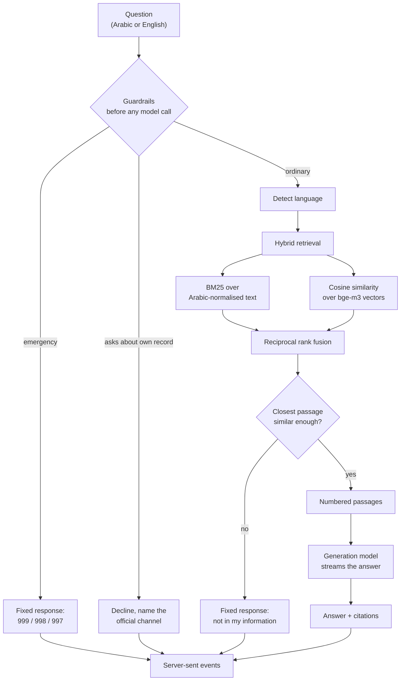

# Shurta Assistant

A bilingual question-answering assistant over public Dubai Police service information, running
entirely on the machine it is installed on. Ask in English, Modern Standard Arabic or Gulf dialect
what a service costs, what documents it needs or how long it takes, and get a short answer with a
citation against each fact and a link to the official page it came from.

> Unofficial project. Not affiliated with, endorsed by or connected to Dubai Police or any other
> authority. See [Data and attribution](#data-and-attribution).

## Highlights

- Bilingual, including dialect and code-switching. A question is answered in the language it was
  asked, and one that mixes the two is handled as Arabic.
- Answers cite their sources, with a link to the official page and the date it was collected.
- Runs on standard hardware — no GPU required. Generation and embedding run locally through
  Ollama, with a roughly four-billion-parameter model at four-bit quantisation.
- Nothing leaves the machine. No question is logged, stored or sent anywhere.
- Guardrails before the model. Emergencies get the emergency numbers immediately, and questions
  about somebody's own case are declined with the official channel named. The assistant declines
  when the retrieved passages do not cover the question, though two adjacent questions in the
  evaluation set still reach the model — see [Limitations](#limitations).
- Measured, not asserted. Retrieval, answer accuracy and latency are evaluated by rule, and the
  reports are in [`eval/`](eval/).

## How it works



[`docs/architecture.md`](docs/architecture.md) explains each part and why it is built that way.

## Requirements

- Python 3.12 — the project pins `==3.12.*`, so 3.11 and 3.13 are both rejected by the install.
- Node 20.19 or newer, for the web interface.
- [Ollama](https://ollama.com) running on the same machine.
- About 6 GB of free memory and 6 GB of disk for the models.

## Quick start

```powershell
git clone https://github.com/Only-A7med/shurta-assistant.git
cd shurta-assistant

python -m venv .venv
.\.venv\Scripts\python.exe -m pip install -e ".[dev]"
Copy-Item .env.example .env          # optional: every default works without it
```

If `python` is not 3.12 the install stops with `requires a different Python`: name the interpreter
instead, as `py -3.12 -m venv .venv` on Windows (`py -0p` lists what you have) or
`python3.12 -m venv .venv` elsewhere. On macOS and Linux use `./.venv/bin/python` in place of the
Windows interpreter path throughout.

Pull the models (about 4.6 GB in total), build the knowledge base from the official public site,
and index it:

```powershell
ollama pull bge-m3
ollama pull gemma3:4b

.\.venv\Scripts\python.exe -m shurta ingest     # 40 services, both languages
.\.venv\Scripts\python.exe -m shurta index      # chunk and embed
.\.venv\Scripts\python.exe -m shurta doctor     # check everything is in place
```

Run the API and the web interface:

```powershell
.\.venv\Scripts\python.exe -m shurta serve      # http://127.0.0.1:8000

cd frontend
npm ci
npm run dev                                     # http://localhost:5173
```

The chat endpoint streams server-sent events, and Arabic text through `curl` is mangled on
Windows, so ask from the command line with Python:

```powershell
.\.venv\Scripts\python.exe -c "import httpx; print(httpx.post('http://127.0.0.1:8000/api/chat', json={'question':'How much is a police clearance certificate?'}, timeout=120).text)"
```

## With Docker

Ollama is not containerised: it stays on the host, where it keeps the model resident between
requests. The containers reach it at `host.docker.internal`.

Pull the models and build the knowledge base as above — the images carry no content — then:

```powershell
docker compose up --build
```

Then open <http://localhost:8080>. The API is on <http://localhost:8000>, with its health at
`/api/health`. `data/` is mounted read-only into the API container, so the catalogue and the index
are the ones built on the host.

## Collecting and refreshing the data

`python -m shurta ingest` reads 40 selected services from the site's own public content interface
in both languages. It identifies itself in its user agent, waits at least two seconds between
requests, and caches every response under `data/raw/`, so re-running it issues no requests at all.
`ingest --refresh` reads the site again, and `index` rebuilds the index afterwards.

Every answer carries the date its source was collected, because the catalogue is a snapshot.
`data/processed/collection-report.md` records which fields the source states and which it leaves
empty.

## Data and attribution

**This repository contains no Dubai Police content.** The knowledge base is collected from the
official public site by whoever runs the project, onto their own machine, and is never committed:
`data/raw/`, `data/processed/` and `data/index/` are all untracked, as are the evaluation key facts
derived from them. What is committed is the collector, the questions, the aggregate scores, and a
small invented catalogue for a fictional city police force that the tests run against.

The collected content belongs to Dubai Police, whose terms reserve all rights over it. Service
information, fees and procedures are theirs; this project only reads the public pages and cites
them. It is an unofficial, unaffiliated demonstration and is not endorsed by Dubai Police or by any
other authority. Nothing here is advice: check <https://www.dubaipolice.gov.ae>, the Dubai Police
app, or call 901 — and 999 in an emergency.

## Guardrails

Three kinds of question never reach a model:

| Question | Response |
|---|---|
| "There is a fire in my building" | The emergency numbers, immediately: 999, 998, 997 |
| "What is the status of my fine?" | Declined — no access to anybody's records — with the official channel named |
| Something the catalogue does not cover | "I could not find this in the service information I have", with the official channels |

Routing is correct for every emergency and every personal-case question in the evaluation set, and
for four of the six out-of-scope ones before any model runs. The other two are adjacent government
services, so they are left to the prompt, which can see the passages and say they cover something
else.

## Evaluation

Measured by rule rather than judged by a model, on the committed question set. The full reports are
[`eval/retrieval-results.md`](eval/retrieval-results.md) and [`eval/results.md`](eval/results.md);
[`docs/architecture.md`](docs/architecture.md) explains what each figure means.

### Retrieval

110 questions with a known answer, against 372 indexed passages.

| Method | recall@1 | recall@3 | recall@5 | MRR |
|---|---:|---:|---:|---:|
| Keyword only (BM25) | 0.827 | 0.909 | 0.945 | 0.878 |
| Vector only (`bge-m3`) | 0.918 | 0.955 | 0.973 | 0.942 |
| Hybrid, fused *(what ships)* | 0.900 | 0.945 | 0.964 | 0.931 |

Fused, by group: English 0.911 · Modern Standard Arabic 0.911 · code-switched 1.000 · Gulf dialect
0.800 at rank 1, reaching 1.000 by rank 5.

Vector search alone is ahead by 2 questions in 110 at rank 1. The fused ranking ships anyway,
because keyword matching holds on to the exact terms an embedding can miss — a service name typed
in Latin script, a figure — and it reaches 1.000 on the 5 code-switched questions, where vector
search alone reaches 0.800. Gulf dialect is the one group where fusion scores below both methods on
their own, 0.800 against 0.867 over 15 questions.

A weighted fusion was swept rather than left untried: weighting towards the stronger vector ranking
moved the overall figures by under one question in 100 and lost the code-switched case outright,
1.000 to 0.800, so the weights stay equal. That was an earlier sweep, over 100 questions, measured
on the same questions its own figures came from — not a held-out result — and it has not been
re-run on the current 110.

### Answers

130 questions. The two instruction models were scored on the same 130, so their columns are
directly comparable; the subset row is not comparable with them and cannot be chosen as the
default.

| Model | Questions | Key facts | All figures | All facts present | Citations valid | Citations present | Language | Behaviour | Composite |
|---|---:|---:|---:|---:|---:|---:|---:|---:|---:|
| **`gemma3:4b`** *(default)* | 130 | **0.826** | 0.719 | 0.689 | 1.000 | 0.955 | 1.000 | 0.992 | **0.920** |
| `qwen3:4b-instruct-2507-q4_K_M` | 130 | 0.755 | 0.657 | 0.541 | 1.000 | 0.973 | 0.985 | 0.992 | 0.898 |
| `qwen3:4b` | 20 *(subset)* | — | — | — | — | — | — | — | — |

Key facts are scored on the variant of a field each question asks about: a question about the fee
*for a resident* is graded on the resident figure, not on the citizen and overseas figures as well.
The all-figures column is the same answers graded against every figure the field states, which is
what earlier runs reported; scoping removes 23 fact failures from each model, so it does not move
them relative to each other.

`gemma3:4b` is the default on accuracy — the two instruction models are within half a second of
each other on time to first token. `qwen3:4b` reasons before answering and the provider offers no
way to switch that off: only 10 of its 20 answers were non-empty, so accuracy is not reported for
it, and its first token takes a median of 39.8 seconds.

### Time to first token

At the shipped defaults `gemma3:4b` reaches its first token in a median of 9.2 seconds over all 130
questions, and 10.8 seconds on a 20-question subset re-run with nothing else on the machine.

A 4-second target was not reached, and is not reachable in these measurements without answering
worse: prompt processing is 99% of the wait, and 4 seconds buys about 200 tokens where the passages
and question alone are around 390. Capping passage length and dropping to three passages both hit
the target and both cost key-fact recall, so both were reverted; naming each service once per group
of passages saved 89 prompt tokens and was kept.

These figures are processor-only and vary from run to run: identical settings have produced 15.0 s
and 18.3 s, so differences under about 20% are not evidence of anything, and anything else
competing for the processor inflates them. Generation threads are left for the provider to choose —
set `NUM_THREAD` to tune it, ideally to the number of physical cores, worth about 2 seconds in
these measurements.

### Why the wrong answers were wrong

Every answerable question that missed a fact or carried no citation was classified by cause.
Retrieval accounts for little of it: 8 of 53 failures for `gemma3:4b`, counted before the questions
recorded which figure they ask for. Nothing was caused by a gap in the source. Six grading rules
turned out to be wrong and are fixed, two of them in the stricter direction — including one that
scored two models 3/3 and 0/3 for naming the same three documents. The counts, the rules and the two
prompt changes that were measured and reverted are in [`eval/results.md`](eval/results.md).

## Development

```powershell
.\.venv\Scripts\python.exe -m ruff check .
.\.venv\Scripts\python.exe -m ruff format --check .
.\.venv\Scripts\python.exe -m mypy
.\.venv\Scripts\python.exe -m pytest -q

cd frontend
npm run lint
npm run build
```

All four backend checks pass with no catalogue, no index and no key facts present, which is what
lets continuous integration run on a fresh clone with no Ollama instance. Continuous integration
also builds both Docker images, so the Dockerfiles are verified on every push.

## Limitations

- Freshness. The catalogue is a snapshot; a fee that changed on the official page yesterday is
  wrong here until the next `ingest`. Every answer carries its collection date.
- Procedure steps are empty for every service, because the source publishes none.
  Approximating them would be inventing procedure.
- Field coverage follows the source. Names, descriptions, eligibility, processing times and
  channels are complete; required documents cover about two services in five and fees about one in
  four.
- Gulf dialect is the weakest group in retrieval: recall@1 of 0.800 over 15 questions, against
  0.911 for English and Modern Standard Arabic, reaching 1.000 by rank 5. It is also the one group
  where fusion scores below keyword and vector search on their own, which both reach 0.867.
- Two out-of-scope questions reach the model, being adjacent government services, and the
  prompt does not reliably decline them.
- No reasoning across services. Retrieval finds passages; it does not compare two services or
  work out a consequence.
- One question at a time. There is no conversation history, by design: nothing a reader types
  is kept.

## Licence

The code is licensed under the MIT Licence — see [LICENSE](LICENSE). The licence covers this
project's own code only, not the collected service information, which belongs to Dubai Police.
