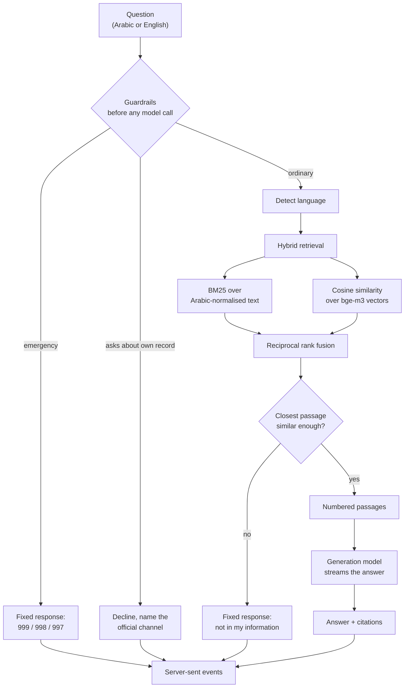

# Shurta Assistant

A bilingual question-answering assistant over public Dubai Police service information, running
entirely on the machine it is installed on. Ask in English, Modern Standard Arabic or Gulf dialect
what a service costs, what documents it needs or how long it takes, and get a short answer with a
citation against each fact and a link to the official page it came from.

> **Unofficial project.** Not affiliated with, endorsed by or connected to Dubai Police or any other
> authority. See [Data and attribution](#data-and-attribution).

<!-- A short recording of a question being answered belongs here:
      -->
*A recording of the interface answering a question in each language goes here.*

## Highlights

- **Bilingual, including dialect and code-switching.** Arabic and English questions are answered in
  the language they were asked, and a question that mixes the two is handled as Arabic.
- **Every fact is cited.** Each answer carries numbered citations linking to the official page and
  the date that page was collected.
- **Runs on standard hardware — no GPU required.** Generation and embedding both run locally
  through Ollama, with a roughly four-billion-parameter model at four-bit quantisation.
- **Nothing leaves the machine.** No question is logged, stored or sent anywhere.
- **Guardrails before the model.** Emergencies get the emergency numbers immediately; questions
  about somebody's own case are declined with the official channel named; questions the collected
  information does not cover are refused rather than guessed at.
- **Measured, not asserted.** Retrieval, answer accuracy and latency are all evaluated by rule, and
  the numbers are in [`eval/`](eval/).

## How it works



[`docs/architecture.md`](docs/architecture.md) explains each part and why it is built that way.

## Requirements

- Python 3.12 or newer
- Node 20.19 or newer (for the web interface)
- [Ollama](https://ollama.com) running on the same machine
- About 6 GB of free memory and 6 GB of disk for the models

## Quick start without Docker

```powershell
git clone https://github.com/Only-A7med/shurta-assistant.git
cd shurta-assistant

python -m venv .venv
.\.venv\Scripts\python.exe -m pip install -e ".[dev]"
Copy-Item .env.example .env          # optional: every default works without it
```

Pull the models (about 4.6 GB in total):

```powershell
ollama pull bge-m3
ollama pull gemma3:4b
```

Build the knowledge base from the official public site, then index it:

```powershell
.\.venv\Scripts\python.exe -m shurta ingest     # 40 services, both languages
.\.venv\Scripts\python.exe -m shurta index      # chunk and embed
.\.venv\Scripts\python.exe -m shurta doctor     # check everything is in place
```

Run the API and the web interface:

```powershell
.\.venv\Scripts\python.exe -m shurta serve      # http://127.0.0.1:8000

cd frontend
npm ci
npm run dev                                     # http://localhost:5173
```

On macOS or Linux the same commands work with `python3 -m venv .venv` and
`./.venv/bin/python` in place of the Windows paths.

### Asking a question from the command line

The chat endpoint streams server-sent events, and Arabic text through `curl` is mangled on Windows,
so use Python:

```powershell
.\.venv\Scripts\python.exe -c "import httpx; print(httpx.post('http://127.0.0.1:8000/api/chat', json={'question':'How much is a police clearance certificate?'}, timeout=120).text)"
```

## Quick start with Docker

Ollama is **not** containerised: it stays on the host, where it keeps the model resident between
requests. The containers reach it at `host.docker.internal`.

```powershell
ollama pull bge-m3
ollama pull gemma3:4b

.\.venv\Scripts\python.exe -m shurta ingest     # the image carries no content
.\.venv\Scripts\python.exe -m shurta index

docker compose up --build
```

Then open <http://localhost:8080>. The API is on <http://localhost:8000> and its health is at
<http://localhost:8000/api/health>.

`data/` is mounted read-only into the API container, so the catalogue and the index are the ones
built on the host.

## How the data is collected and refreshed

`python -m shurta ingest` reads 40 selected services from the site's own public content interface in
both languages. It identifies itself in its user agent, waits at least two seconds between
requests, and caches every response under `data/raw/`, so re-running it issues no requests at all.

```powershell
.\.venv\Scripts\python.exe -m shurta ingest --refresh   # read the site again
.\.venv\Scripts\python.exe -m shurta index              # rebuild the index
```

Every answer carries the date its source was collected, because the catalogue is a snapshot.
`data/processed/collection-report.md` records which fields the source states and which it leaves
empty.

## Data and attribution

**This repository contains no Dubai Police content.** The knowledge base is collected from the
official public site by whoever runs the project, onto their own machine, and is never committed:
`data/raw/`, `data/processed/` and `data/index/` are all untracked, as are the evaluation key facts
derived from them. What is committed is the collector, the questions, the aggregate scores, and a
small invented catalogue for a fictional city police force that the tests run against.

The collected content belongs to **Dubai Police**, whose terms reserve all rights over it. Service
information, fees and procedures are theirs; this project only reads the public pages and cites
them. It is an unofficial, unaffiliated demonstration and is not endorsed by Dubai Police or by any
other authority. Nothing here is advice: check <https://www.dubaipolice.gov.ae>, the Dubai Police
app, or call 901 — and **999 in an emergency**.

## Guardrails

Three kinds of question never reach a model:

| Question | Response |
|---|---|
| "There is a fire in my building" | The emergency numbers, immediately: 999, 998, 997 |
| "What is the status of my fine?" | Declined — no access to anybody's records — with the official channel named |
| Something the catalogue does not cover | "I could not find this in the service information I have", with the official channels |

Over the whole evaluation set the routing is correct for every emergency and every personal-case
question, and for four of the six out-of-scope ones before any model runs. The other two are
genuinely adjacent government services and are left to the prompt, which can see the passages and
say they cover something else.

## Evaluation

Everything below is measured by rule rather than judged by a model, on the committed question set.
See [`eval/retrieval-results.md`](eval/retrieval-results.md) and [`eval/results.md`](eval/results.md)
for the full reports, and [`docs/architecture.md`](docs/architecture.md) for what each figure means.

### Retrieval

110 questions with a known answer, against 372 indexed passages.

| Method | recall@1 | recall@3 | recall@5 | MRR |
|---|---:|---:|---:|---:|
| Keyword only (BM25) | 0.827 | 0.909 | 0.945 | 0.878 |
| Vector only (`bge-m3`) | **0.918** | **0.955** | **0.973** | **0.942** |
| Hybrid, fused *(what ships)* | 0.900 | 0.945 | 0.964 | 0.931 |

Vector search alone scores slightly higher overall — two questions in 110 — but the fused ranking
is what ships, because it answers every code-switched question at rank 1 where vector search
misses one in five. Losing a whole class of question is worse than a point of overall accuracy.

Fused, by group: English 0.911 · Modern Standard Arabic 0.911 · code-switched 1.000 ·
Gulf dialect 0.800 at rank 1, reaching 1.000 by rank 5.

### Answers

130 questions. The two instruction models were scored on **the same 130**, so their columns are
directly comparable; the subset row is not comparable with them and cannot be chosen as the
default.

| Model | Questions | Key facts | All facts present | Citations valid | Citations present | Language | Behaviour | Composite |
|---|---:|---:|---:|---:|---:|---:|---:|---:|
| **`gemma3:4b`** *(default)* | 130 | **0.726** | **0.583** | 1.000 | 0.955 | 1.000 | 0.992 | **0.890** |
| `qwen3:4b-instruct-2507-q4_K_M` | 130 | 0.663 | 0.450 | 1.000 | 0.973 | 0.985 | 0.992 | 0.871 |
| `qwen3:4b` | 20 *(subset)* | 0.262 | 0.250 | 1.000 | 0.400 | 0.500 | 1.000 | 0.545 |

`gemma3:4b` is the default on accuracy: the two instruction models are within half a second of
each other on time to first token, so speed does not separate them. `qwen3:4b` reasons before
answering and the provider offers no way to switch that off, so half of its answers came back
empty — the whole token budget went on reasoning the reader never sees.

**`key_fact_recall` is a lower bound.** It requires every figure a field states, including ones
the question did not ask about: a question about the fee *for a resident* is marked as missing the
citizen fee, the overseas fee and the knowledge-and-innovation dirhams. Of `gemma3:4b`'s 39
answers counted as omitting a fact, 30 are figures the question never asked for and 9 are genuine
omissions. See [`eval/results.md`](eval/results.md).

### Time to first token

Measured on a fixed 20-question subset so every change is compared on the same questions.

| | Prompt tokens | First token p50 |
|---|---:|---:|
| Before | 706 | 15.0–18.3 s |
| After — service named once per group of passages | 617 | 13.6 s |
| Re-measured later, same subset and settings, nothing else running | 617 | 10.8 s |

A 4-second target was **not** reached, and is not reachable here without answering worse: prompt
processing is 99% of the wait, and a 4-second budget buys about 200 tokens where the passages and
question alone are around 390. Capping passage length and dropping to three passages both hit the
target and both cost key-fact recall, so both were reverted.

**These figures are processor-only, and they vary from run to run.** Identical settings have
produced 15.0 s and 18.3 s, so differences under about 20% are not evidence of anything. They
depend on the machine and on what else is running on it; anything else competing for the processor
inflates them. Generation threads are left for the provider to choose — set `NUM_THREAD` to tune
it, ideally to the number of physical cores, which was worth about 2 seconds here.

### Why the wrong answers were wrong

Every answerable question that missed a fact or carried no citation, classified by cause. Both
models on the same 130 questions.

| Cause | `gemma3:4b` | `qwen3:4b-instruct` |
|---|---:|---:|
| Retrieval did not return the right service in the top 4 | 2 | 3 |
| The service was returned, but no retrieved passage states the fact | 6 | 6 |
| A passage stated the fact and the answer left it out or changed it | 39 | 49 |
| The answer carried no citation at all | 5 | 3 |
| The grading rule was wrong — **fixed**, with a test for each | 5 classes | 5 classes |
| Flagged as a grading fault, read by hand, and wasn't one | 1 | 1 |
| The source does not state the fact | 0 | 0 |

Retrieval accounts for little of it: 8 of 53 failures for `gemma3:4b`. Five grading rules turned
out to be wrong and are fixed, two of them in the stricter direction — including one that scored
two models 3/3 and 0/3 for naming the same three documents.

## Development

```powershell
.\.venv\Scripts\python.exe -m ruff check .
.\.venv\Scripts\python.exe -m ruff format --check .
.\.venv\Scripts\python.exe -m mypy
.\.venv\Scripts\python.exe -m pytest -q

cd frontend
npm run lint
npm run build
```

All four backend checks pass with no catalogue, no index and no key facts present, which is what
lets continuous integration run on a fresh clone with no Ollama instance.

## Limitations

- **Freshness.** The catalogue is a snapshot; a fee that changed on the official page yesterday is
  wrong here until the next `ingest`. Every answer carries its collection date.
- **Procedure steps are empty for every service**, because the source publishes none. Approximating
  them would be inventing procedure.
- **Field coverage follows the source.** Names, descriptions, eligibility, processing times and
  channels are complete; required documents cover about two services in five and fees about one in
  four.
- **Gulf dialect is the weakest group in retrieval**, though not by much: recall@1 of 0.800
  against 0.911 for English and Modern Standard Arabic, reaching 1.000 by rank 5. An earlier
  run put it at 0.400, but that was over five questions; on fifteen the gap is far smaller, and
  fifteen is still a small sample.
- **No reasoning across services.** Retrieval finds passages; it does not compare two services or
  work out a consequence.
- **One question at a time.** There is no conversation history, by design: nothing a reader types is
  kept.

## Licence

The code is licensed under the MIT Licence — see [LICENSE](LICENSE). The licence covers this
project's own code only, not the collected service information, which belongs to Dubai Police.
