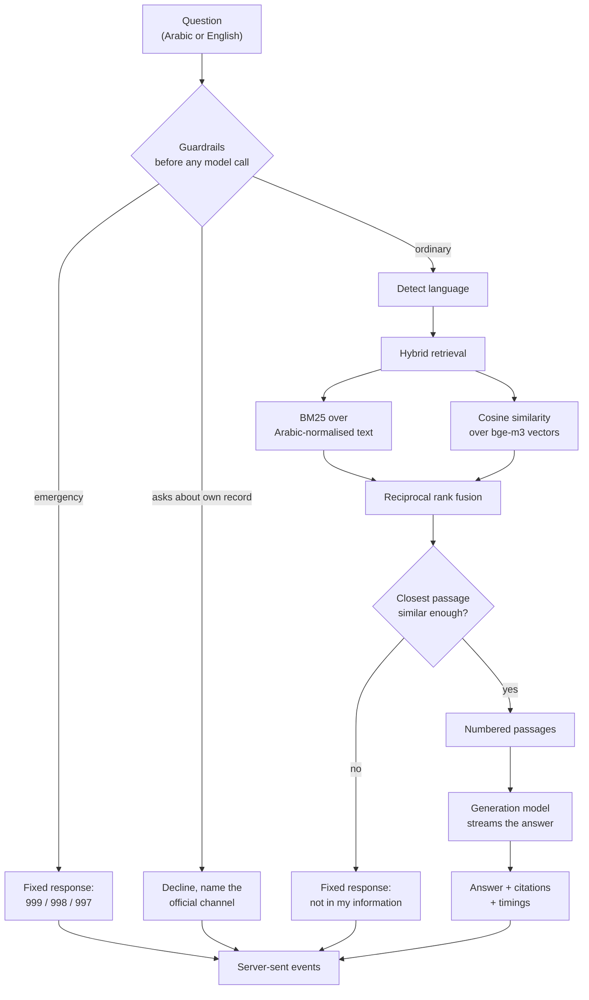

# Architecture

How a question becomes a cited answer, and why each part is built that way.

## The problem

A reader asks, in Arabic or English, what a public service costs, what documents it needs, or how
long it takes. The answer is on an official page. The difficulty is not writing prose: it is getting
the *right fee* into the answer, in the *right language*, with a link to where it came from, while
running on an ordinary machine with no graphics card and a few gigabytes of memory for the whole
stack.

Those constraints drive the decisions below.

## The pipeline

Three of the five outcomes never reach a model. Each is a case where a model could only make things
worse.

## Collection

The official service pages are rendered by a browser-side application: fetching a page route returns
44 kilobytes of markup yielding about 300 characters of visible text. The same content is served by
the site's own public content interface as structured JSON, in both languages, already separated
into description, fees, documents and channels. Reading that needs no browser automation, costs a
fraction of the bandwidth, and puts far less load on the site.

The collector:

- identifies itself in its user agent, with a link to the project;
- waits at least two seconds between requests, however fast they come back;
- caches every response in `data/raw/` and reads from there next time, so an interrupted run resumes
  and developing the normalisation step costs no requests;
- refuses a response that is not JSON, because the site answers rejected requests with an HTML error
  page under a `200` status.

**The repository contains no collected content.** The official terms reserve all rights over it, so
the knowledge base is built on your own machine by `python -m shurta ingest`, and `data/raw/`,
`data/processed/` and `data/index/` are untracked. What is committed is the collector and a small
invented catalogue for a fictional city police force, which the tests and continuous integration run
against.

### What the schema leaves empty

Each service is normalised into a fixed shape: names, category, description, eligibility, required
documents, fees, processing time, channels, steps, per-language source URLs, and a collection date. A
field the source does not state is left empty rather than filled in, and `ingest` writes a coverage
report next to the catalogue so the gaps are visible. In the current collection, descriptions and
processing times are complete, required documents cover about two services in five, fees about one in
four, and `steps` is empty for every service.

`steps` being permanently empty looks like a bug and is not: no step-by-step procedure is published
for any of these services, and approximating one from the channel text would be inventing procedure.

## Arabic normalisation

Arabic writes the same word several ways, and none of the differences carry meaning:

| Written | Also written | What differs |
|---|---|---|
| `الإقامة` | `الاقامة` | alef with hamza, or bare alef |
| `شهادة` | `شهاده` | ta marbuta, or ha |
| `دعوى` | `دعوي` | alef maqsura, or ya |
| `شــهادة` | `شهادة` | tatweel, a justification stretch |
| `شَهَادَة` | `شهادة` | vowel marks |
| `٥٠٠` | `500` | Arabic-Indic digits |

A reader treats these as the same word; exact token matching does not. So the indexed text and the
query both pass through one normaliser, which removes diacritics and tatweel, unifies the alef forms,
folds ta marbuta onto ha and alef maqsura onto ya, converts Arabic-Indic digits to Western ones, and
strips the definite article from the front of a token so `الشهادة` matches `شهادة`.

The transformation is lossy and is applied **only** to the text used for matching. What the reader
sees, and what goes into the prompt, is the source's own wording.

Two details are easy to get wrong, and are tested:

- The article is stripped only when enough of the word remains; taking `ال` off a three-letter word
  leaves a stub.
- Matching happens on **tokens**, not substrings. `لص` ("thief") is a substring of `الصلاحية`
  ("validity"), which once turned a question about an expired identity card into an emergency.

Language detection uses the same normaliser and leans towards Arabic: a question is Arabic once a
fifth of its letters are Arabic script. A code-switched question is mostly Latin letters by count,
but a reader who writes any Arabic expects an Arabic answer.

## Chunking

One chunk is **one section of one service in one language** — the fees of the police clearance
certificate in English, its required documents in Arabic.

Coarser is wasteful: a whole service in one chunk drags the eligibility conditions, the channel list
and the opening hours into the prompt alongside the fee, which on processor-only inference is paid
for in memory and in time to first token. Finer is useless: "Resident: AED 200" on its own cannot be
answered from without knowing which service and which fee it belongs to.

Every chunk carries its service's name in both languages, its section heading, its source URL and its
collection date. The bilingual naming costs a few tokens and is what lets an Arabic question land on
an English passage.

## Retrieval

Two methods run, and each covers the other's failure.

**BM25** matches the words actually typed. It is exact about a figure, a service name or an
identifier, and it is the only one of the two that reliably finds a rare term. It cannot match a
question to a passage that says the same thing in different words, and it cannot cross languages at
all: Arabic `الرسوم` shares no token with English "fees".

**Cosine similarity over `bge-m3` embeddings** crosses both gaps, because the model places text with
the same meaning near each other regardless of language. It is weaker on a specific string, and will
rank a passage about a different certificate close to the right one.

BM25 is written out in the repository rather than taken from a library for one reason: the tokeniser
has to be the Arabic-normalising one above, on both the passages and the query, or Arabic keyword
search barely works. Once the tokeniser is yours, the rest of BM25 is about forty lines.

### Why reciprocal rank fusion

The two rankings have incomparable scores: BM25 returns an unbounded sum of term weights, cosine
similarity a number between minus one and one. Normalising either onto the other's scale means
inventing a mapping that would change with the corpus.

Reciprocal rank fusion throws the scores away and keeps the positions. A passage scores
`1 / (k + rank)` in each ranking it appears in, and the contributions are added. A passage both
methods rank highly wins; a passage only one found still places. With `k` at the standard 60, first
and second place differ by under two per cent, so one method being slightly more confident does not
override agreement between both.

### The trade-off, measured

Measured over the questions with a known answer:

| Method | recall@1 | recall@5 | Code-switched recall@1 |
|---|---:|---:|---:|
| Keyword only | 0.810 | 0.940 | 1.000 |
| Vector only | 0.910 | 0.970 | 0.800 |
| Fused | 0.890 | 0.960 | 1.000 |

Vector search alone is better overall, by two questions in a hundred. The fused ranking is still the
default because it is the only configuration that answers every code-switched question correctly,
where vector search alone misses one in five: a service name typed in Latin script inside an Arabic
sentence is found by keyword search and missed by the embedding. Losing a class of question is worse
than losing a point of overall accuracy.

Weighting the fusion towards the stronger vector ranking was tried and reverted: the sweep moved the
overall figures by less than one question in a hundred and cost the code-switched case outright. The
weights exist in the code and are set to one.

A small preference is applied to passages in the reader's own language. Both languages are always
searched, but when two passages say the same thing, the one in the reader's language is the better
citation.

### Why no vector database

The corpus is a few hundred passages. The dense side is a single NumPy array of about a megabyte, and
an exhaustive cosine similarity over it is a matrix multiply that finishes in well under a
millisecond. A server would add a process, a protocol and a failure mode in exchange for approximate
search the corpus is far too small to need.

An index is three files: `vectors.npy` (unit-length rows, so cosine similarity is a dot product),
`chunks.json` in the same order, and `index.json` holding the lexical index and the build metadata.
The metadata records which embedding model built the index, and `doctor` refuses one built with a
different model: vectors from two models are not comparable, and the resulting nonsense would be
silent.

End to end, retrieval takes about 50 to 70 milliseconds once the embedding model is resident. All of
the perceptible wait is generation.

## Guardrails

Two kinds of question are answered without a model.

An **emergency** needs a telephone number in the first line. On processor-only inference the first
token can be seconds away and the answer could be wrong, so an emergency intent short-circuits the
pipeline and returns a fixed response naming 999, 998 and 997. The detector is tuned to fire readily:
a false positive costs one unnecessary line of emergency numbers, a miss costs much more. What stops
it firing constantly is an override for phrasings that ask *about* a service — "how do I report a
robbery?" names a robbery but asks about a reporting service.

A **personal-case lookup** — "what is the status of my fine?" — cannot be answered from published
information by anybody, because the answer lives in a record this project has no access to and should
not have. These are declined with the official channel named. Detection needs two things together: a
reference to the reader's own record *and* a request for a value from it. Either alone is ordinary,
which is why "can I pay my traffic fines in instalments?" is answered normally.

Every question in the evaluation set, emergency and personal-case included, is classified as
intended.

## The relevance floor

When nothing retrieved is close enough, a fixed "not in my information" response is returned rather
than asking a model to work from an empty context, which is where a model of this size starts
inventing.

The obvious signal, the fused retrieval score, **does not work**: it is built from rank positions
alone, so the top passage scores near the maximum whether or not it is relevant. Measured,
out-of-scope questions scored *higher* on it than most answerable ones.

Raw cosine similarity is an absolute measure and does separate them:

| | lowest | median | highest |
|---|---:|---:|---:|
| Answerable questions | 0.526 | 0.697 | 0.804 |
| Out-of-scope questions | 0.355 | 0.471 | 0.566 |

The distributions overlap, and honestly so: "how do I renew my driving licence" really is close to
the traffic services in the corpus. So the floor is set at 0.50, *below* every answerable question
rather than between the two groups. It rejects nothing the catalogue can answer and catches four of
the six out-of-scope questions before any model runs. The remaining two are the genuinely adjacent
government services, left to the prompt, which can see the passages and say they cover something
else. A higher floor would start refusing questions the catalogue does answer, which is worse.

## Generation

The prompt has one job: get a small model to restate retrieved text accurately, in the reader's
language, with a citation against each claim, and to say it does not know rather than fill a gap.

Three things in it are shaped by the model being small:

- **The rules are few and ordered by importance.** A four-billion-parameter model follows the first
  few lines of an instruction block and drifts from the rest, so "use only the passages", "answer in
  this language" and "cite" come first.
- **The passages are numbered and those numbers are what it is asked for.** Asking for a citation it
  would have to invent invites invention; asking it to copy a number in front of it is a copying
  task, which these models are reliable at.
- **The language instruction appears twice**, at the top and immediately before the answer. Otherwise
  an Arabic question gets an English answer whenever the retrieved passages are English.

The system block comes first and is byte-identical between requests in the same language, so the
provider can reuse its cached prompt prefix. A test asserts this, because moving anything variable
above the rules would silently cost seconds per question.

### Reasoning

Some instruction models reason before answering. The provider reports that reasoning in a separate
field and the answer in another, but its `think` request parameter does **not** switch the reasoning
off. It switches off the *separation*, after which the reasoning arrives in the answer field and
cannot be told apart from the answer: answers opened with "Okay, the user is asking…" and hit the
token cap before saying anything.

So the client never sends that parameter. It lets the provider separate the two and uses only the
answer, which is correct for a model that reasons and a no-op for one that does not. The real lever
is choosing a model whose reasoning does not have to be paid for, and that is what the answer
evaluation measures.

## The interface

`POST /api/chat` streams server-sent events in a fixed order: a `start` event carrying the detected
language and the citations — sent *before* any generation, so the interface can set its text
direction and show the right state immediately — then `token` events, then a `done` event with the
citations and timings, or an `error` event carrying whatever was produced before the failure.

The framing splits a payload across several `data:` lines. Without that, every answer would truncate
at its first newline, and answers are full of newlines because every list has them.

`GET /api/health` reports each part separately — provider reachable, each model pulled, index loaded,
catalogue present — and names the command that fixes whatever is missing. Start-up does not fail when
the index or the provider is absent: somebody who has just cloned the repository should get an API
that starts and a health page that explains itself, not a stack trace at boot.

Warming the generation model runs as a background task, so the port accepts connections immediately
and health reports `status: "warming"` until the model is loaded. That state is `200`, not `503`:
warming is usable, only slower. The web interface polls health while warming and tells the reader the
first answer will take longer.

The model client is reached only through a small interface, which is how the whole API is tested
against a stand-in with no provider running, and how a second provider would arrive.

## Privacy

Nothing a reader types is stored. There is no session, no identifier and no history. The question is
held in memory for the length of the request and is not written to any log unless `LOG_QUESTIONS` is
turned on deliberately, which it is not by default. A test asserts that the response does not echo
the question back. Generation and embedding both run on the machine the assistant is installed on, so
no question leaves it.

## What this design is not good at

- **Freshness.** The catalogue is a snapshot. A fee that changed on the official page yesterday is
  wrong here until the next `ingest`. Every answer carries a collection date.
- **Anything the source does not state.** Procedure steps are published for no service, so the
  assistant cannot walk somebody through an application.
- **Gulf dialect, relative to the other groups.** It is the weakest group measured, recovering by
  rank 5 but not reliably at rank 1.
- **Reasoning across services.** Retrieval finds passages; it does not compare two services or work
  out a consequence. A question whose answer requires combining three services gets the closest
  passages and an answer limited to them.
